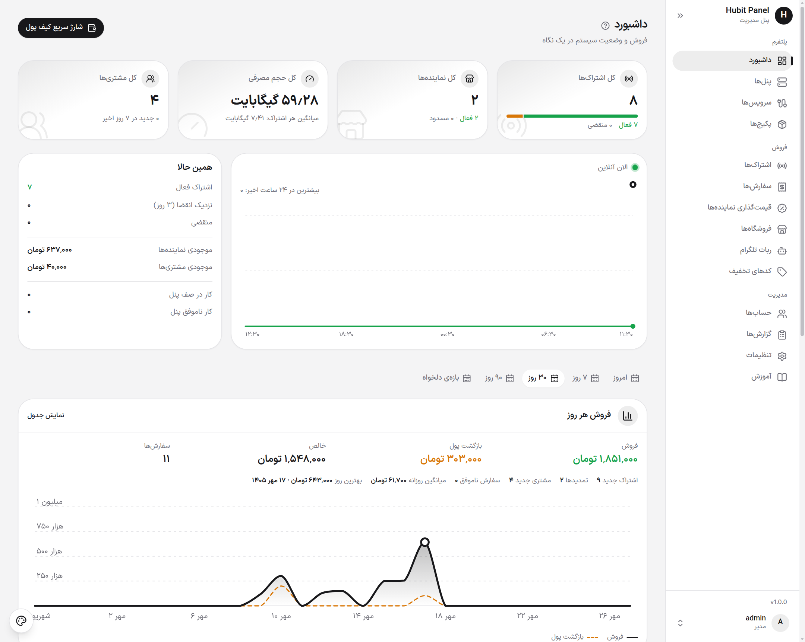

<div align="center">

# هابیت پنل (Hubit Panel)

**فروش، تمدید و مدیریت اشتراک VPN، کاملاً خودکار.**

یک سیستم فروش همه‌کاره برای پنل‌های **PasarGuard**، **3x-ui** و **Marzban**:
پنل ادمین · پنل نماینده · وب‌اپ مشتری · ربات تلگرام.

[English](README.md) | **فارسی**

📣 **کانال تلگرام: [t.me/ihubit](https://t.me/ihubit)**


<br>



</div>

<div dir="rtl" align="right">

## چرا هابیت پنل

- **کاملاً خودکار.** مشتری پرداخت می‌کند، کاربر روی پنل شما ساخته می‌شود و لینک تحویل داده می‌شود. تمدید، بازگشت وجه، اعلان‌ها و پشتیبان‌گیری خودشان اجرا می‌شوند.
- **همهٔ کانال‌های فروش.** پنل ادمین، نمایندگان با کیف پول، وب‌اپ مشتری و ربات تلگرام همراه با مینی‌اپ.
- **پنل عوض شود، لینک‌ها نه.** لینک اشتراک روی دامنهٔ خودتان است و با عوض‌شدن پنل پشت آن تغییر نمی‌کند.
- **با همان چیزی که دارید شروع کنید.** کاربران یک پنل موجود را وارد کنید یا پنل ازدست‌رفته را از دادهٔ خودتان دوباره بسازید.
- **در چند دقیقه آماده.** یک دستور همه چیز را با HTTPS خودکار نصب می‌کند و به‌روزرسانی از داخل پنل انجام می‌شود.

## امکانات

| | |
|---|---|
| **پنل ادمین** | مدیریت کامل، فروش تکی، قیمت‌گذاری گروهی نمایندگان، کد تخفیف، گزارش‌ها، تاریخچهٔ تغییرات و پشتیبان‌گیری روزانهٔ دیتابیس. |
| **پنل نماینده** | فروش از پکیج‌های تخصیص‌داده‌شده یا پلن‌های دلخواه، پرداخت از کیف پول، تحویل با QR، تمدید، ساخت گروهی و زیرنماینده. |
| **وب‌اپ مشتری** | فروشگاه، اشتراک‌های من، شارژ کیف پول، تست رایگان، دعوت دوستان و دریافت پاداش. |
| **ربات تلگرام و مینی‌اپ** | خرید، تمدید، شارژ و دریافت اعلان قبل از پایان اشتراک. |
| **چند لوکیشن** | یک پکیج در چند کشور، هر کشور با قیمت خودش؛ خریدار کشور را انتخاب می‌کند و تمدید در همان کشور انجام می‌شود. |
| **پنل‌ها** | PasarGuard، 3x-ui (نسخه‌های 2.x و 3.x) و Marzban. کاربران یک پنل موجود را وارد کنید، یا پنل ازدست‌رفته را از دادهٔ خودتان دوباره بسازید. |
| **لینک اشتراک** | روی دامنهٔ خودتان، بدون تغییر با عوض‌شدن پنل. لینک‌های پنل قبلی هم کار می‌کنند. |
| **پرداخت** | زرین‌پال، NOWPayments و کارت‌به‌کارت، با قوانین بازگشت وجه و پاداش دعوت. |
| **رابط کاربری** | فارسی و انگلیسی، تم روشن و تیره، مناسب موبایل و دسکتاپ. |

## شروع سریع

```bash
bash <(curl -fsSL https://raw.githubusercontent.com/hubit-git/panel/main/install.sh)
```

یک سرور لینوکس با دسترسی root و یک دامنهٔ اشاره‌کننده به آن لازم است. جزئیات در بخش «نصب روی سرور» پایین‌تر است.

## پیش‌نیازها

- یک سرور لینوکس (اوبونتو یا دبیان پیشنهاد می‌شود). پیشنهادی: ۱ هسته CPU، ۲ گیگابایت RAM، ۱۰ گیگابایت دیسک.
- **یک دامنه** که به سرور اشاره کند (رکورد `A` با IP سرور). پنل گواهی HTTPS را خودش می‌گیرد، برای همین دامنه لازم است.
- پورت‌های **۸۰** و **۴۴۳** آزاد باشند (برنامهٔ دیگری از آن‌ها استفاده نکند).
- دسترسی root (یا `sudo`). اگر Docker نصب نباشد، خودش نصب می‌شود.

## نصب روی سرور (Docker، پیشنهادی)

۱. برای دامنه‌تان (مثلاً `panel.example.com`) یک رکورد `A` بسازید که به IP سرور اشاره کند.

۲. با کاربر root وارد سرور شوید و همین یک دستور را بزنید:

```bash
bash <(curl -fsSL https://raw.githubusercontent.com/hubit-git/panel/main/install.sh)
```

دستور دامنه را می‌پرسد، در صورت نیاز Docker را نصب می‌کند، رمزهای دیتابیس را می‌سازد، پنل را با HTTPS خودکار بالا می‌آورد و صبر می‌کند تا جواب بدهد. در پایان آدرس پنل و مشخصات دیتابیس برای نصب‌کننده را چاپ می‌کند.

اگر نمی‌خواهید دامنه را بپرسد، آن را در دستور بدهید:

```bash
DOMAIN=panel.example.com bash <(curl -fsSL https://raw.githubusercontent.com/hubit-git/panel/main/install.sh)
```

۳. آدرس `https://your-domain` را در مرورگر باز کنید. نصب‌کنندهٔ وب مشخصات دیتابیس را می‌خواهد (اسکریپت چاپ کرده است: host برابر `db`، port برابر `3306`، name و user برابر `panel` و رمز) و نام کاربری و رمز حساب ادمین شما را.

۴. **کرون را اضافه کنید** (الزامی است: ساخت کاربر روی پنل، مصرف، پرداخت‌ها و پشتیبان‌گیری همه با آن اجرا می‌شوند). در پنل ادمین به *مدیریت ← تنظیمات ← عمومی* بروید، در کارت *آدرس سایت و cron* دکمهٔ «کپی خط wget» را بزنید و خط را به crontab سرور (`crontab -e`) اضافه کنید. شکلش این است و هر دقیقه اجرا می‌شود:

```
* * * * * wget -q -O- "https://panel.example.com/cron/run?key=YOUR_CRON_KEY"
```

۵. صفحهٔ **راهنما** در پنل ادمین گام‌های اول را فهرست کرده است: اتصال پنل خودتان، ساخت سرویس‌ها و پکیج‌ها، تنظیم آدرس‌ها و درگاه‌های پرداخت.

اجرای دوبارهٔ دستور نصب روی همان سرور بی‌خطر است: داده و رمزهای شما را نگه می‌دارد.

## به‌روزرسانی

به‌روزرسانی از داخل خود پنل و بدون هیچ کاری روی سرور انجام می‌شود: *مدیریت ← تنظیمات ← بروزرسانی* و دکمهٔ **نصب همین حالا**. پنل قبل از هر به‌روزرسانی یک نسخه از دیتابیس نگه می‌دارد و اگر مشکلی پیش بیاید نسخهٔ قبلی را برمی‌گرداند.

## پشتیبان‌گیری و بازیابی

پنل هر روز از دیتابیس نسخهٔ پشتیبان می‌گیرد (*مدیریت ← تنظیمات ← پشتیبان‌گیری*) و می‌تواند فایل را در تلگرام برای شما بفرستد. بازیابی از همان صفحه یا هنگام نصب روی یک سرور تازه ممکن است.

## مدیریت سرور

فایل‌های نصب در `/opt/hubit-panel` هستند:

```bash
cd /opt/hubit-panel
docker compose ps                  # چه چیزی در حال اجراست
docker compose logs app --tail 50  # لاگ پنل (یا: web، db)
docker compose restart             # راه‌اندازی دوبارهٔ همه چیز
docker compose down                # توقف (داده می‌ماند)
docker compose up -d               # شروع دوباره
```

## حذف

این کار پنل را **و همهٔ دادهٔ آن** را پاک می‌کند. اول پشتیبان بگیرید.

```bash
cd /opt/hubit-panel && docker compose down -v && cd / && rm -rf /opt/hubit-panel
```

## رفع مشکل

- **صفحه باز نمی‌شود یا گواهی صادر نمی‌شود:** مطمئن شوید دامنه به سرور اشاره می‌کند و پورت‌های ۸۰ و ۴۴۳ در فایروال سرور و شرکت میزبانی باز هستند. بعد لاگ را ببینید: `cd /opt/hubit-panel && docker compose logs web --tail 30`.
- **«پورت ۸۰ یا ۴۴۳ در حال استفاده است»:** برنامه‌ای که از آن استفاده می‌کند (مثلاً nginx یا apache) را متوقف کنید و دستور نصب را دوباره بزنید.
- **رمز ادمین را گم کرده‌ام:** روی سرور این دستور را بزنید (یک فایل علامت می‌سازد و `RECOVERY_KEY` را نشان می‌دهد):

  ```bash
  cd /opt/hubit-panel && docker compose exec app sh -c 'touch storage/temp/allow-password-reset; grep ^RECOVERY_KEY= .env'
  ```

  بعد تا ۲۰ دقیقه `https://your-domain/recovery` را باز کنید و مقدار `RECOVERY_KEY`، نام کاربری ادمین و رمز جدید را بدهید. فایل علامت بعد از یک بار استفاده پاک می‌شود.

## نصب روی هاست اشتراکی

به‌زودی.

---

هابیت پنل به‌صورت یک بستهٔ آمادهٔ اجرا منتشر می‌شود. این مخزن فقط ریلیزها و فایل‌های نصب را نگه می‌دارد.

</div>
