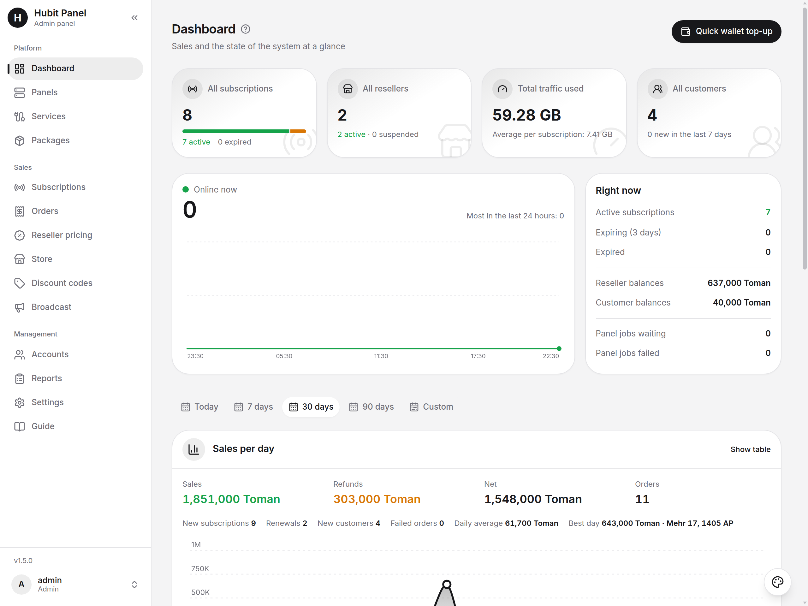

<div align="center">

# Hubit Panel

**Sell, renew and manage VPN subscriptions on autopilot.**

An all-in-one sales system for your **PasarGuard** and **3x-ui** panels:
admin panel · reseller panel · customer web app · Telegram bot.

**English** | [فارسی](README.fa.md)


<br>



</div>

## Why Hubit Panel

- **Fully automatic.** A customer pays, the user is created on your panel, the link is delivered. Renewals, refunds, notices and backups run by themselves.
- **Every sales channel.** Your own admin panel, resellers with a wallet, a customer web app and a Telegram bot with a Mini App.
- **Your panel can change, your links will not.** Subscription links live on your own domain and stay the same when the panel behind them is replaced.
- **Start with what you have.** Import the users of an existing panel, or rebuild a lost one from your own data.
- **Up in minutes.** One command installs everything with automatic HTTPS, and updates install from inside the panel.

## Features

| | |
|---|---|
| **Admin panel** | Full management, single sales, bulk reseller pricing, discount codes, reports, a change log and a daily database backup. |
| **Reseller panel** | Sell from assigned packages or your own custom plans, pay from a wallet, QR hand-over, renewals, bulk creation and sub-resellers. |
| **Customer web app** | Shop, my subscriptions, wallet top-up, free trial, invite friends and earn rewards. |
| **Telegram bot and Mini App** | Buy, renew, top up and get notices before a subscription ends. |
| **Panels** | PasarGuard and 3x-ui (2.x and 3.x). Import the users of an existing panel, or rebuild a lost panel from your own data. |
| **Subscription links** | On your own domain, unchanged when the panel behind them changes. Links from an old panel keep working. |
| **Payments** | ZarinPal, NOWPayments and card to card, with refund rules and referral rewards. |
| **Interface** | Persian and English, light and dark themes, made for phones and desktops. |

## Quick start

```bash
bash <(curl -fsSL https://raw.githubusercontent.com/hubit-git/panel/main/install.sh)
```

You need a Linux server with root access and a domain pointing to it. Details are in [Install on a server](#install-on-a-server-docker-recommended) below.

## Requirements

- A Linux server (Ubuntu or Debian is recommended). Recommended: 1 vCPU, 2 GB RAM, 10 GB disk.
- **A domain** that points to the server (an `A` record with the server's IP address). The panel gets its HTTPS certificate by itself, so the domain is required.
- Ports **80** and **443** free (nothing else using them).
- Root access (or `sudo`). Docker is installed for you if it is missing.

## Install on a server (Docker, recommended)

1. Create an `A` record for your domain (for example `panel.example.com`) pointing to the server's IP address.
2. Log in to the server as root and run this one command:

```bash
bash <(curl -fsSL https://raw.githubusercontent.com/hubit-git/panel/main/install.sh)
```

It asks for your domain, installs Docker if needed, creates the passwords of the database, starts the panel with automatic HTTPS and waits until it answers. At the end it prints the address of your panel and the database login for the installer.

To give the domain without being asked:

```bash
DOMAIN=panel.example.com bash <(curl -fsSL https://raw.githubusercontent.com/hubit-git/panel/main/install.sh)
```

3. Open `https://your-domain` in a browser. The web installer asks for the database login (the script printed it: host `db`, port `3306`, name `panel`, user `panel`, and the password) and for the username and password of your admin account.
4. **Add the cron job** (required: creating users on the panel, usage, payments and backups all run from it). In the admin panel open *Management → Settings → General*, card *Site address and cron*, press the wget copy button and add the line to the server's crontab (`crontab -e`). It looks like this and runs every minute:

```
* * * * * wget -q -O- "https://panel.example.com/cron/run?key=YOUR_CRON_KEY"
```

5. The **Guide** page of the admin panel lists the first steps: connect your panel, add services and packages, set the addresses and the payment gateways.

Running the install command again on the same server is safe: it keeps your data and passwords.

## Update

Updates are installed from inside the panel, with no work on the server: *Management → Settings → Updates*, then **Install now**. Before each update the panel saves a copy of the database, and it puts the old version back if something fails.

## Backup and restore

The panel saves the database every day (*Settings → Backup*) and can send the file to you in Telegram. A backup can be restored from the same page, or while installing on a new server.

## Managing the server

The files of the installation are in `/opt/hubit-panel`:

```bash
cd /opt/hubit-panel
docker compose ps                  # what is running
docker compose logs app --tail 50  # the log of the panel (or: web, db)
docker compose restart             # restart everything
docker compose down                # stop (the data stays)
docker compose up -d               # start again
```

## Uninstall

This deletes the panel **and all its data**. Make a backup first.

```bash
cd /opt/hubit-panel && docker compose down -v && cd / && rm -rf /opt/hubit-panel
```

## Troubleshooting

- **The page does not open or the certificate is not issued:** check that the domain points to the server and that ports 80 and 443 are open in the firewall of the server and of the hosting company. Then look at the log: `cd /opt/hubit-panel && docker compose logs web --tail 30`.
- **"Port 80 or 443 is already used":** stop the program that uses it (for example nginx or apache), then run the install command again.
- **I lost the admin password:** run this on the server (it creates a marker file and shows your `RECOVERY_KEY`):

  ```bash
  cd /opt/hubit-panel && docker compose exec app sh -c 'touch storage/temp/allow-password-reset; grep ^RECOVERY_KEY= .env'
  ```

  Then within 20 minutes open `https://your-domain/recovery` and enter the `RECOVERY_KEY`, the admin username and a new password. The marker file is deleted after one use.

## Install on shared hosting

Coming soon.

---

Hubit Panel is distributed as a ready-to-run package. This repository holds its releases and the install files only.
